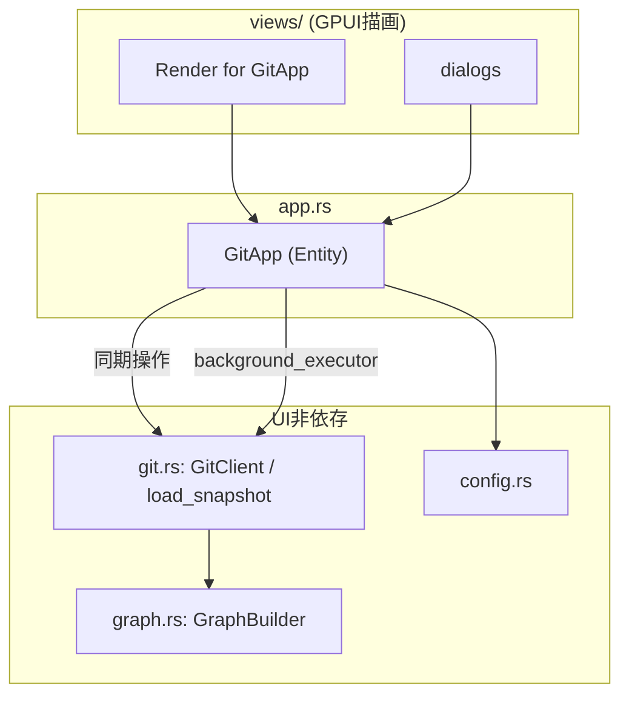

# 開発者ガイド

RustGitGUIの開発に参加するための情報をまとめています。

## 技術スタック

| 技術 | バージョン | 用途 |
|------|-----------|------|
| gpui-kit | 0.9 | UI フレームワーク（GPUI + gpui-component） |
| git2 | 0.20 | Git操作（libgit2バインディング） |
| chrono | 0.4 | 日時処理 |
| dirs | 6.0 | 設定ファイルパス取得 |
| serde / serde_json | 1.0 | 設定ファイルの読み書き |

ファイルダイアログ・クリップボード・URLを開く処理はGPUI標準の機能（`prompt_for_paths` / `write_to_clipboard` / `open_url`）を使用しています。

Rustのバージョンは `rust-toolchain.toml` で固定しています（GPUIが新しいRustを要求するため）。

## プロジェクト構成

```
rust-git-gui/
├── Cargo.toml
├── rust-toolchain.toml   # Rustバージョン固定
├── src/
│   ├── main.rs           # エントリポイント（ウィンドウ作成）
│   ├── app.rs            # アプリ状態（GitApp）と操作
│   ├── git.rs            # GitClient・Diff解析・非同期用ヘルパー（UI非依存）
│   ├── graph.rs          # Git Graphのレーン計算（UI非依存）
│   ├── config.rs         # 設定ファイル（リポジトリ一覧・コミット履歴）
│   ├── model.rs          # 画面表示用データ構造
│   └── views/            # 画面描画
│       ├── mod.rs        # ルートレイアウト・配色・共通部品
│       ├── toolbar.rs    # 上部ツールバー
│       ├── sidebar.rs    # Local/Remote/Stash一覧
│       ├── graph.rs      # コミットグラフ・変更ファイル一覧
│       ├── diff.rs       # Diff表示
│       ├── commit_panel.rs # コミットモード（Stage/Unstage/メッセージ）
│       ├── repo_list.rs  # リポジトリ一覧（ドラッグ&ドロップ）
│       └── dialogs.rs    # 入力・確認ダイアログ
└── docs/
```

## アーキテクチャ



- 画面状態はすべて `GitApp` が保持し、`views/` は `impl GitApp` の描画メソッドとして実装しています。
- 状態の再読み込み（`git::load_snapshot`）、コミットDiff計算、Fetch/Pull/Push/Cloneは `background_executor` で別スレッド実行し、完了後に `GitApp` を更新します。
- Stage/Unstage/コミットなどの軽い操作はUIスレッドで実行し、その後バックグラウンドで再読み込みします。

## 主要コンポーネント

### GitClient (`src/git.rs`)

| メソッド | 説明 |
|---------|------|
| `open_repo()` | リポジトリを開く |
| `get_commits_with_graph()` | コミット履歴とグラフデータ取得 |
| `get_status()` | Staged/Unstagedファイル取得 |
| `stage_file()` / `unstage_file()` / `stage_hunk()` | ステージング |
| `commit()` | コミット作成 |
| `push()` / `pull()` | リモート操作 |
| `checkout_branch()` / `merge_branch()` | ブランチ操作 |
| `stash_save()` / `stash_pop()` | Stash操作 |

### GraphBuilder (`src/graph.rs`)

VSCode Git Graph風のコミットグラフ計算エンジン。

- コミットの親子関係からブランチ線を計算
- 色分け（16色パレット）
- 行ごとの線分・ベジェ曲線（`GraphRow`）を生成し、`views/graph.rs` の `canvas` で描画

## ビルド方法

```bash
cargo build
cargo build --release
cargo run
```

### Linuxでのビルド

GPUIのビルドには追加のシステムライブラリが必要です（例: Ubuntu）。

```bash
sudo apt install libxkbcommon-x11-dev libxcb1-dev libvulkan-dev libwayland-dev libfontconfig-dev
```

## 設定ファイル

`dirs::config_dir()/git-client/` に保存されます：

- `recent_repos.json` - リポジトリ一覧（グループを含む）
- `commit_history.json` - コミットメッセージ履歴
